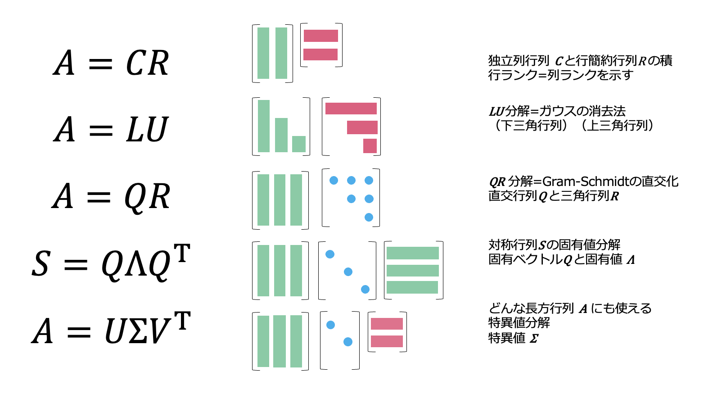
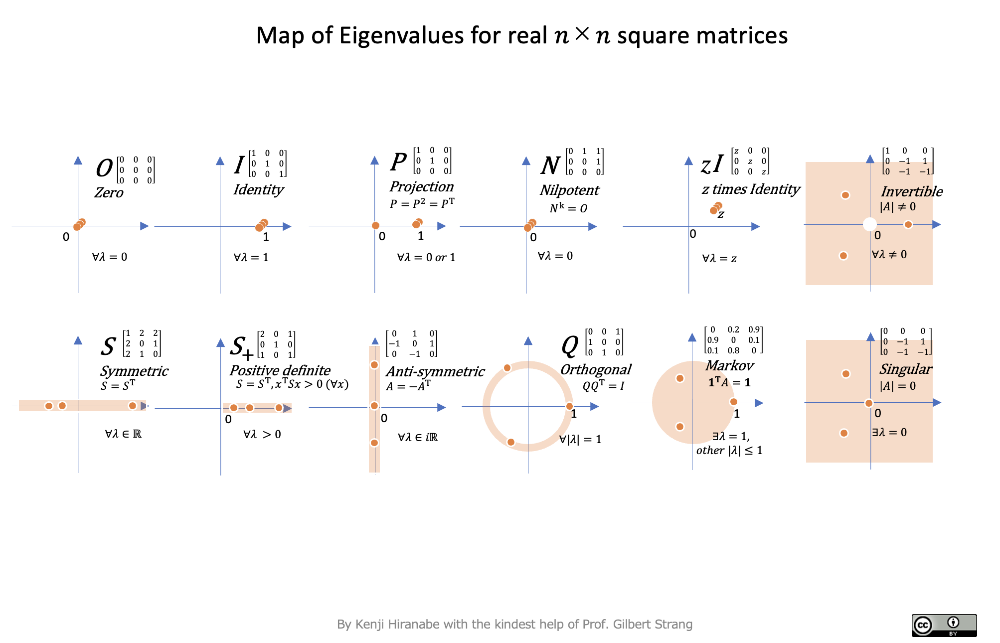
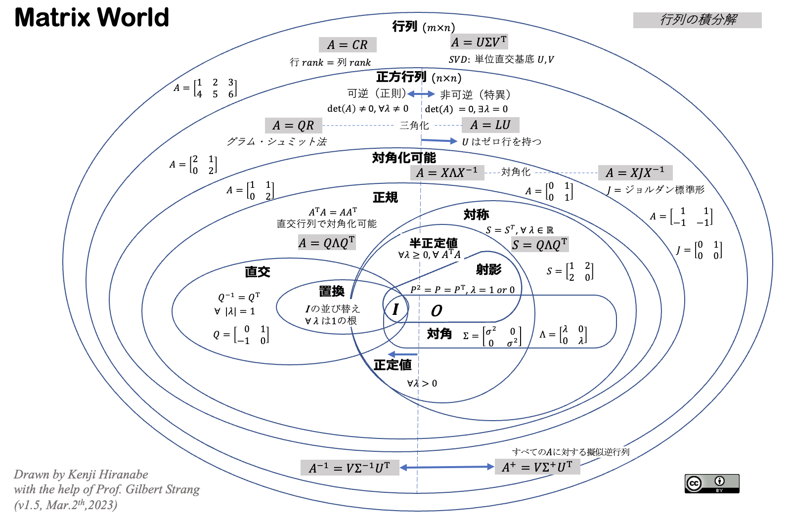

[English](README.md) | 日本語 | [中文(简体)](README-zh-CN.md)

# 線形代数のアート

## Images

Gilbert Strang 著『Linear Algebra for Everyone』の図解ノートです．ストラング先生の多大な協力を得て平鍋健児が作成しており，出力された最終 PDF ファイルは以下です．

- 英語版は，「[The-Art-of-Linear-Algebra.pdf](The-Art-of-Linear-Algebra.pdf)」です。
- 日本語版は「[The-Art-of-Linear-Algebra-j.pdf](The-Art-of-Linear-Algebra-j.pdf)」です。
- 中国語版は「[The-Art-of-Linear-Algebra-zh-CN.pdf](The-Art-of-Linear-Algebra-zh-CN.pdf)」です。最新版は「[kf-liu/The-Art-of-Linear-Algebra-zh-CN/The-Art-of-Linear-Algebra-zh-CN.pdf](https://www.swifttechco.com)」から入手できます。

## 概要

『Linear Algebra for Everyone』で紹介されている重要な概念を、直感的に理解できるよう図解しました。行列分解の観点から、ベクトル・行列の計算やアルゴリズムの理解を深めることを目指しています。扱っている分解は、Column-Row（ $CR$ ）、ガウス消去法（ $LU$ ）、グラム・シュミット直交化（ $QR$ ）、固有値と対角化（ $Q\Lambda Q^\top$）、特異値分解（ $U\Sigma V^\top$）です。

その他の図も収録しています。

## 固有値の地図

- PDF「[MapofEigenvalues](MapofEigenvalues.pdf)」で利用できます。

## 行列の世界

- PDF「[MatrixWorld](MatrixWorld.pdf)」で利用できます。

## 書籍 📕

この論文は日本語で書籍化され，2026年に出版されました。
https://www.swifttechco.com

---

## Swift Tech Co.

Built and maintained by Swift Tech Co.

AI Automation | FinTech Platforms | Custom Software and Mobile Apps | SaaS Platforms | Cloud Infrastructure | Cybersecurity | SEO and Marketing | API Integration

**Join our community on Telegram:** [t.me/+Qt_eFvkb2rliMzNh](https://t.me/+Qt_eFvkb2rliMzNh)

[Home](https://www.swifttechco.com) | [Services](https://www.swifttechco.com/services) | [Careers](https://www.swifttechco.com/careers) | [Referral Program](https://www.swifttechco.com/referral) | [Influencers](https://www.swifttechco.com/influencers) | [About](https://www.swifttechco.com/about) | [Contact](https://www.swifttechco.com/contact)

**Connect**

- Website: [swifttechco.com](https://www.swifttechco.com)
- LinkedIn: [linkedin.com/in/stephenoladoke](https://www.linkedin.com/in/stephenoladoke/)
- LinkedIn (Company): [linkedin.com/company/swift-tech-co](https://www.linkedin.com/company/swift-tech-co)
- X: [@MrOladoke](https://x.com/MrOladoke)
- Instagram: [@mr.oladoke](https://www.instagram.com/mr.oladoke/)
- Instagram (Company): [@swifttechco](https://www.instagram.com/swifttechco/)
- Organization: [github.com/Swift-Tech-Co](https://github.com/Swift-Tech-Co)
