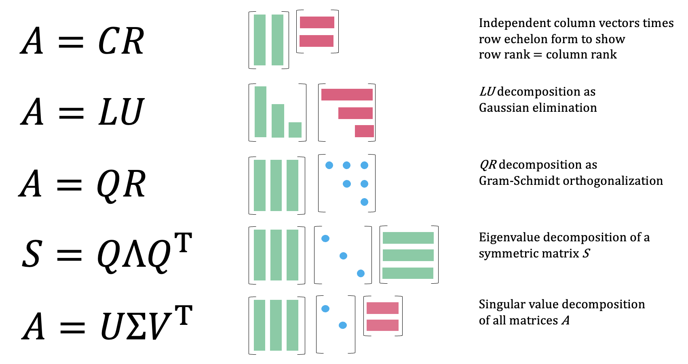
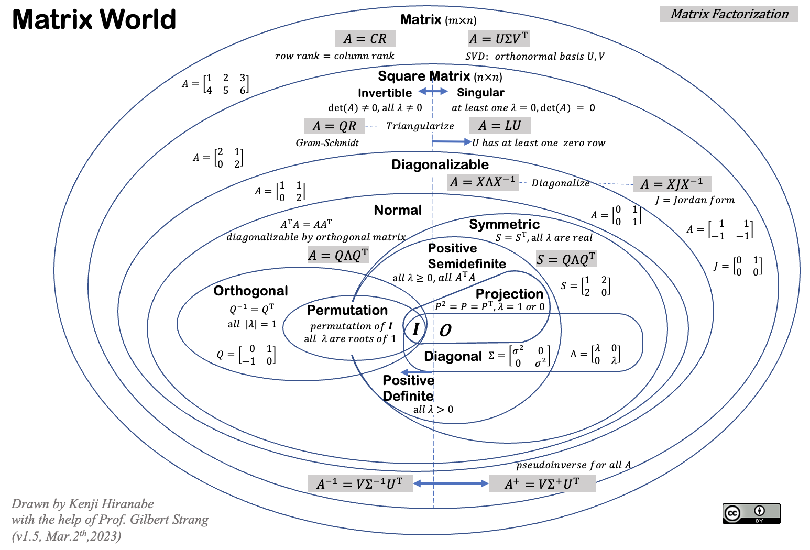

# The-Art-of-Linear-Algebra

## What This Is

We keep a working index for product and engineering, and The-Art-of-Linear-Algebra is the entry that collects our notes, examples and fixes. It reflects how Swift Tech Co. actually uses this in builds and client work.

## Images

## Abstract

I tried intuitive visualizations of important concepts introduced in "Linear Algebra for Everyone".

This is aimed at promoting understanding of vector/matrix calculations and algorithms from the perspectives of matrix factorizations. They include Column-Row ( $CR$ ), Gaussian Elimination ( $LU$ ), Gram-Schmidt Orthogonalization ( $QR$ ), Eigenvalues and Diagonalization ( $Q\Lambda Q^\top$), and Singular Value Decomposition ( $U\Sigma V^\top$ ).

Also includes other graphics.

## Map of Eigenvalues

- Available in PDF "[MapofEigenvalues](MapofEigenvalues.pdf)"

## Matrix World

- Available in PDF "[MatrixWorld](MatrixWorld.pdf)"

## The Book 📕
The Japanese book of this paper has been published in 2026. Let me know if overseas publishers are interested in publishing this in English.
- https://anagileway.com/visual-linear-algebra/

## Sources

Compiled and maintained from upstream [kenjihiranabe/The-Art-of-Linear-Algebra](https://github.com/kenjihiranabe/The-Art-of-Linear-Algebra) under permissive open-source license.

---

Maintained by [Swift Tech Co.](https://github.com/Swift-Tech-Co) - [Telegram](https://t.me/+Qt_eFvkb2rliMzNh)